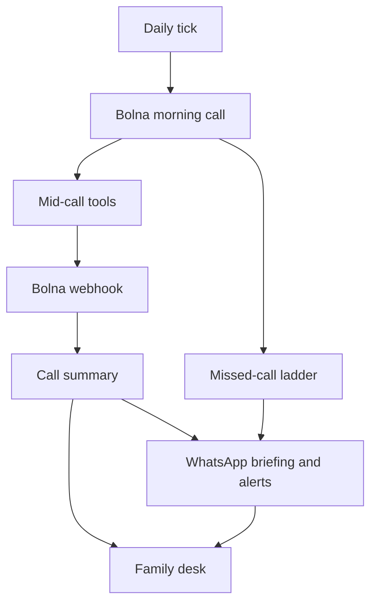

# Saathi

A morning phone call for a parent in India, on the phone they already own. The adult child gets a short briefing and a family desk. Companionship and reminders — never diagnosis. In an emergency, call 112.

Mocks stay on by default. Nothing dials or messages a real person until you put a number on the allowlist and turn live flags on yourself.

## Quick start

```bash
npm install
cp .env.example .env.local
npm run dev
```

Open [http://127.0.0.1:43147](http://127.0.0.1:43147). Set up a family, or open the labelled EXAMPLE desk at [`/d/example-kamla`](http://127.0.0.1:43147/d/example-kamla). Add `?lang=hi` for हिं.

| Command | What it does |
| --- | --- |
| `npm run dev` | Family desk at port 43147 |
| `npm run seed` | Reset the Kamla Sharma EXAMPLE household |
| `npm test` | Unit tests (PGlite, mocks on) |
| `npm run lint` | ESLint |
| `npm run typecheck` | `tsc --noEmit` |
| `npm run e2e` | Playwright at 360×740 (needs Chromium once) |
| `npm run db:migrate` | Apply SQL migrations (Postgres when `DATABASE_URL` is set) |

Marketing site: `cd landing && npm install && npm run dev` → [http://127.0.0.1:43211](http://127.0.0.1:43211).

Latent Spaces film (HyperFrames, real desk screens): `cd brag-output/composition && npx hyperframes@0.8.185 preview`. Render only after you have watched it.

## How it fits together



The parent never opens a website. If nobody answers, the same-day ladder retries, then asks the child and — if they opted in — a neighbour. First ack wins.

Settings **Test call** is an extra same-day ring: transcript, medicines, and alerts land on History and Today as soon as the call finishes.

## Repo map

| Path | Role |
| --- | --- |
| `src/app` | Next.js App Router (desk, onboard, APIs) |
| `src/components` | Family desk UI |
| `src/lib` | Domain logic — see [docs/code-map.md](./docs/code-map.md) |
| `scripts/` | Bolna, WhatsApp, brand, Android CLIs |
| `landing/` | Marketing site (own `package.json`) |
| `android/` | Capacitor shell |
| `fixtures/bolna` | Webhook fixtures |
| `docs/` | Specs and runbooks — [index](./docs/README.md) |

Local data is PGlite at `.data/saathi`. Set `DATABASE_URL` for Postgres. Tests always use PGlite.

## Safety

- Every call, WhatsApp, email, or push goes through `gateOutbound`.
- Live targets must be on `ALLOWED_PHONE_NUMBERS` / `ALLOWED_EMAILS`.
- `SAATHI_KILL_SWITCH=1` (or `/ops`) stops cron, dials, and sends.
- `/admin` is a password-gated dump of households, calls, transcripts, and actions. Set `ADMIN_PASSWORD` (or sign in with `OPS_EMAILS`). `/ops` stays counts-and-gates only.
- Defaults: `CALL_PROVIDER=simulated`, `MOCK_BOLNA=1`, `MOCK_WHATSAPP=1`, `MOCK_EMAIL=1`, `PARTNER_MODE=mock`.
- The kill switch also blocks creating a demo pharmacy handoff and Place order. `/partner/mock/[id]` is a fake shop named Saathi Pharmacy (demo). No real pharmacy, payment, or prescription.
- Never invent family data. Fake rows are labelled EXAMPLE.

Env names: [`.env.example`](./.env.example). Deploy and first live call: [`docs/saathi/engineering/deploy.md`](./docs/saathi/engineering/deploy.md). How to extend this codebase: [`docs/code-map.md`](./docs/code-map.md).
