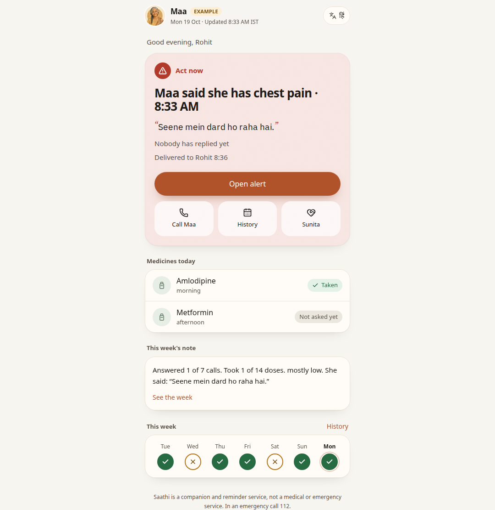

<p align="center">
  
</p>

<h1 align="center">Saathi</h1>

<p align="center">
  A morning phone companion for aging parents in India.
</p>

<p align="center">
  <a href="https://x-navy-tau.vercel.app"><strong>Live demo</strong></a> ·
  <a href="https://x-navy-tau.vercel.app/d/example-kamla">Example family desk</a> ·
  <a href="./docs/README.md">Docs</a>
</p>

Saathi calls the parent on the phone they already own, checks on medicines, mood, and safety red flags, and sends the adult child a short WhatsApp briefing plus a live family desk.

<p align="center">
  
</p>

> Saathi provides companionship and reminders — **never a medical diagnosis.** In an emergency, call 112.

## How it works

**Parent** — Receives a scheduled morning call in their own language. Saathi asks about sleep, each medicine, how they're feeling, and a few safety checks. No app or website is ever required.

**Child** — Receives a short WhatsApp briefing after each call, plus access to a family desk (Today, History, Alerts, Settings) at `/d/[token]`. Settings allow an extra same-day test call. Demo data is clearly labelled EXAMPLE.

**Neighbour** *(optional)* — Only receives an escalation alert if they've opted in, and only when the missed-call ladder requires someone nearby to check in. The first person to acknowledge takes the task.

## Privacy and consent

- Written child consent is collected at onboarding. Parent voice consent is captured on the call itself.
- Transcripts and quotes are retained for a limited time, then deleted. Alerts can be retained without the underlying transcript.
- Every call, WhatsApp message, email, or push notification passes through `gateOutbound`. Live targets must be present on `ALLOWED_PHONE_NUMBERS` / `ALLOWED_EMAILS`.
- `SAATHI_KILL_SWITCH=1` (or the `/ops` route) immediately stops all cron jobs, dials, and outbound sends.
- See [docs/safety.md](./docs/safety.md) for full details.

## Stack

Next.js (App Router) and TypeScript at the repo root. PGlite for local development, Postgres when `DATABASE_URL` is set. Tailwind CSS with a small internal UI kit. Bolna powers the voice agent (mocked by default). Meta's Cloud API handles WhatsApp (mocked by default). A Capacitor Android shell lives in `android/`, and the marketing site lives in `landing/`.

## Quick start (mock mode)

```bash
npm install
cp .env.example .env.local
npm run dev
npm test
```

Open [http://127.0.0.1:43147](http://127.0.0.1:43147). Set up a family, or open the labelled EXAMPLE desk at [`/d/example-kamla`](http://127.0.0.1:43147/d/example-kamla). Add `?lang=hi` for Hindi.

Mocks are on by default. Nothing dials or messages a real person until you add a number to the allowlist and enable the live flags yourself.

| Command | What it does |
| --- | --- |
| `npm run dev` | Family desk at port 43147 |
| `npm run seed` | Reset the Kamla Sharma EXAMPLE household |
| `npm test` | Unit tests (PGlite, mocks on) |
| `npm run lint` | ESLint |
| `npm run typecheck` | `tsc --noEmit` |
| `npm run e2e` | Playwright at 360x740 (needs Chromium once) |
| `npm run db:migrate` | Apply SQL migrations (Postgres when `DATABASE_URL` is set) |

Marketing site: `cd landing && npm install && npm run dev` → [http://127.0.0.1:43211](http://127.0.0.1:43211).

## Layout

| Path | Role |
| --- | --- |
| `src/app` | Next.js App Router (desk, onboard, APIs) |
| `src/components` | Family desk UI |
| `src/lib` | Domain logic. See [docs/code-map.md](./docs/code-map.md) |
| `scripts/` | Bolna, WhatsApp, brand, Android CLIs |
| `landing/` | Marketing site (own `package.json`) |
| `android/` | Capacitor shell |
| `fixtures/bolna` | Webhook fixtures |
| `docs/` | Architecture, safety, product and voice specs. [Index](./docs/README.md) |

Local data is stored in PGlite at `.data/saathi`. Tests always run against PGlite.

## Status

**Live on the hosted desk (example data only):** family desk, onboarding form, demo walkthrough, mock morning call, mock WhatsApp preview, missed-call ladder simulation, kill switch UI.

**Mocked until you change the environment yourself:** Bolna dials (`MOCK_BOLNA=1`, `CALL_PROVIDER=simulated`), WhatsApp Graph sends (`MOCK_WHATSAPP=1`), email (`MOCK_EMAIL=1`). The demo pharmacy is a clearly labelled fake shop (`PARTNER_MODE=mock`). Saathi does not call any real pharmacy, payment, or prescription API.

WhatsApp template copy is DRAFT until Meta approves it. Unapproved templates fall back to email automatically.

Environment variables: [`.env.example`](./.env.example). Deploy notes: [`docs/saathi/engineering/deploy.md`](./docs/saathi/engineering/deploy.md). Extending the codebase: [`docs/code-map.md`](./docs/code-map.md).

---

<p align="center"><sub>Built for the Bolna Buildathon.</sub></p>
