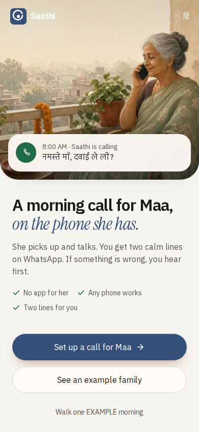

# Saathi


A morning phone companion for aging parents in India. Saathi calls the parent on the phone they already own, checks medicines, mood and red flags, and sends the adult child a short WhatsApp briefing plus a family desk.

**Live app (example household):** [https://x-navy-tau.vercel.app](https://x-navy-tau.vercel.app) · desk: [`/d/example-kamla`](https://x-navy-tau.vercel.app/d/example-kamla)



Companionship and reminders. Never diagnosis. In an emergency, call 112.

## How it works

**Parent.** A scheduled morning call in their language. Saathi asks about sleep, each medicine, how they feel, and a few safety checks. They never open a website.

**Child.** A short WhatsApp briefing after the call, and a family desk (Today, History, Alerts, Settings) at `/d/[token]`. Settings can place an extra same-day test ring. Fake rows are labelled EXAMPLE.

**Neighbour.** Optional. They only get an escalation alert if they opted in, and only when the missed-call ladder asks someone to go over. First ack wins.

## Privacy and consent

- Written child consent at onboarding. Parent voice consent is spoken on the call.
- Transcripts and quotes are retained for a limited time, then deleted. Alerts can remain without her words.
- Every call, WhatsApp, email, or push goes through `gateOutbound`. Live targets must be on `ALLOWED_PHONE_NUMBERS` / `ALLOWED_EMAILS`.
- `SAATHI_KILL_SWITCH=1` (or `/ops`) stops cron, dials, and sends.
- See [docs/safety.md](./docs/safety.md).

## Stack

Next.js (App Router) and TypeScript at the repo root. PGlite locally, Postgres when `DATABASE_URL` is set. Tailwind and a small UI kit. Bolna for the voice agent (mocked by default). Meta Cloud API for WhatsApp (mocked by default). Capacitor Android shell in `android/`. Marketing site in `landing/`.

## Quick start (mock mode)

```bash
npm install
cp .env.example .env.local
npm run dev
npm test
```

Open [http://127.0.0.1:43147](http://127.0.0.1:43147). Set up a family, or open the labelled EXAMPLE desk at [`/d/example-kamla`](http://127.0.0.1:43147/d/example-kamla). Add `?lang=hi` for हिं.

Mocks stay on by default. Nothing dials or messages a real person until you put a number on the allowlist and turn live flags on yourself.

| Command | What it does |
| --- | --- |
| `npm run dev` | Family desk at port 43147 |
| `npm run seed` | Reset the Kamla Sharma EXAMPLE household |
| `npm test` | Unit tests (PGlite, mocks on) |
| `npm run lint` | ESLint |
| `npm run typecheck` | `tsc --noEmit` |
| `npm run e2e` | Playwright at 360x740 (needs Chromium once) |
| `npm run db:migrate` | Apply SQL migrations (Postgres when `DATABASE_URL` is set) |

Marketing site: `cd landing && npm install && npm run dev` -> [http://127.0.0.1:43211](http://127.0.0.1:43211).

## Layout

| Path | Role |
| --- | --- |
| `src/app` | Next.js App Router (desk, onboard, APIs) |
| `src/components` | Family desk UI |
| `src/lib` | Domain logic. See [docs/code-map.md](./docs/code-map.md) |
| `scripts/` | Bolna, WhatsApp, brand, Android CLIs |
| `landing/` | Marketing site (own `package.json`) |
| `android/` | Capacitor shell |
| `fixtures/bolna` | Webhook fixtures |
| `docs/` | Architecture, safety, product and voice specs. [Index](./docs/README.md) |

Local data is PGlite at `.data/saathi`. Tests always use PGlite.

## Status

**Live on the hosted desk (example data only):** family desk, onboarding form, demo walkthrough, mock morning call, mock WhatsApp preview, missed-call ladder in simulation, kill switch UI.

**Mocked unless you change env yourself:** Bolna dials (`MOCK_BOLNA=1`, `CALL_PROVIDER=simulated`), WhatsApp Graph sends (`MOCK_WHATSAPP=1`), email (`MOCK_EMAIL=1`). The demo pharmacy is a labelled fake shop (`PARTNER_MODE=mock`). Saathi does not call a real pharmacy, payment, or prescription API.

WhatsApp template copy is DRAFT until Meta approves it. Unapproved names fall back to email in code.

Env names: [`.env.example`](./.env.example). Deploy notes: [`docs/saathi/engineering/deploy.md`](./docs/saathi/engineering/deploy.md). Extending the codebase: [`docs/code-map.md`](./docs/code-map.md).

Started at the Bolna x YC Voice AI Buildathon, Oct 2026.
