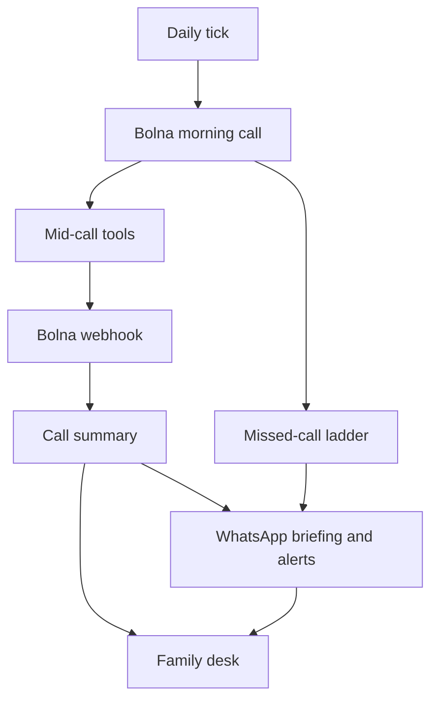

# Saathi

Saathi is a morning phone call for a parent in India, on the phone they already own. The adult child gets a short WhatsApp briefing and an optional family desk. Companionship and reminders — never diagnosis. In an emergency, call 112.

## Try it (30 seconds)

```bash
npm i && npm run dev
```

Open http://127.0.0.1:43147/demo — one EXAMPLE morning, mocks on, nothing dials. Add `?record=1` to play it through for a film. `?lang=hi` for हिं.

Pass/fail for a dry-run: [`docs/saathi/product/dry_run.md`](./docs/saathi/product/dry_run.md). Run that locally before deploying.

## How it fits together



The parent never opens a website. If nobody answers, the same-day ladder retries through `placeCall` / `gateOutbound` (morning cap is separate from retries, each retry linked by `parent_call_id`), then asks the child and — if they opted in — a neighbour. First ack wins. Retries are not claimed as tested on a real line.

## Safety design

- **Gate.** Every call, WhatsApp, email, or push goes through `gateOutbound`.
- **Allowlist.** Live targets must be on `ALLOWED_PHONE_NUMBERS` / `ALLOWED_EMAILS`.
- **Kill switch.** `SAATHI_KILL_SWITCH=1` or `/ops` Turn on stops cron, dials, and sends.
- **Consent.** The child writes consent at setup. The parent says haan or no on the first call. Two “later” mornings stop calling.
- **Retention.** Transcripts go after 30 days; summaries and quotes after 90. Alerts stay without her words.
- **Never diagnoses.** No dose advice. The copy always keeps the 112 line.

Defaults stay `CALL_PROVIDER=simulated`, `MOCK_BOLNA=1`, `MOCK_WHATSAPP=1`. Agents never flip those live.

## Stack

Next.js (App Router, TypeScript) + Tailwind + shadcn/ui. Local data is PGlite; Postgres when `DATABASE_URL` is set. Bolna for the PSTN call. Meta Cloud API for WhatsApp (mocked until Priyansh says go). Family desk is a PWA. Marketing site lives in `landing/`.

Two apps:

| App | Directory | Dev server |
| --- | --- | --- |
| Family desk | repo root | `npm run dev` → http://127.0.0.1:43147 |
| Marketing landing | `landing/` | `cd landing && npm run dev` → http://127.0.0.1:43211 |

Child setup: `/onboard`. EXAMPLE household: `/d/example-kamla` (fictional, labelled EXAMPLE). Specs in [`docs/saathi/`](./docs/saathi/).

The family desk PWA (`/manifest.webmanifest`, `/sw.js`) caches the app shell on successful GETs and never `/api`. Web Push goes through `gateOutbound` and is mocked while `MOCK_WHATSAPP=1`.

## Run locally

```bash
npm install
cp .env.example .env.local
npm run dev          # family desk, port 43147
npm run seed         # reset Kamla Sharma EXAMPLE
npm test
npm run lint
npm run e2e         # Playwright at 360×740, mocks on, isolated PGlite. Under 3 minutes.
                    # Once: npx playwright install chromium

cd landing && npm install && npm run dev   # landing, port 43211
```

Local data is PGlite at `.data/saathi` when `DATABASE_URL` is unset. Set `DATABASE_URL` to a Postgres URL (Supabase) and run `npm run db:migrate`. Tests always use PGlite.

Images go through `next/image` with `sizes`. Fonts are subset (latin Inter/serif, Devanagari Noto) and not preloaded. Compiled CSS is inlined (`npm run prebuild`). Today, Alerts, and History stay server-rendered.

## Mocks and allowlist

`MOCK_BOLNA=1`, `MOCK_WHATSAPP=1`, and `MOCK_EMAIL=1` by default. Morning calls go through `CALL_PROVIDER` (`simulated` by default; `MOCK_BOLNA=0` is an alias for `bolna`). Nothing dials or sends on install, deploy, or `npm run dev`. Cron is authenticated and **not** enabled on deploy. Sunday evening IST, the same tick logs a mocked weekly WhatsApp note for each family.

Every call, WhatsApp, SMS, or email goes through `gateOutbound` and `ALLOWED_PHONE_NUMBERS` / `ALLOWED_EMAILS`. Kill switch: `SAATHI_KILL_SWITCH=1`.

## Env (names only)

| Name | Default | Used for |
| --- | --- | --- |
| `CALL_PROVIDER` | `simulated` | `simulated` or `bolna`. Default simulated. Never set to `bolna` unless Priyansh says go. |
| `MOCK_BOLNA` | `1` | Mock dials. `0` is an alias for `CALL_PROVIDER=bolna`. Never set to `0` unless Priyansh says go. |
| `MOCK_WHATSAPP` | `1` | Mock WhatsApp. Same rule. |
| `MOCK_EMAIL` | `1` | Mock email fallback. Same rule. Unset Resend/SMTP marks the row `undelivered`, never `sent`. |
| `EMAIL_FROM` | empty | From address for Resend or SMTP. Required for a live send. |
| `RESEND_API_KEY` / `EMAIL_API_KEY` | empty | Resend. `EMAIL_API_KEY` is an alias. |
| `SMTP_HOST` / `SMTP_PORT` / `SMTP_USER` / `SMTP_PASS` | empty | SMTP fallback when Resend is unset. |
| `SAATHI_KILL_SWITCH` | `0` | Stops cron, dials, and sends. |
| `ALLOWED_PHONE_NUMBERS` | empty | Live allowlist. |
| `ALLOWED_EMAILS` | empty | Live email fallback allowlist. |
| `OPS_EMAILS` | empty | Signed-in emails that can open `/ops`. Others get 404. |
| `RETENTION_TRANSCRIPT_DAYS` | `30` | Daily tick deletes call transcripts older than this. |
| `RETENTION_SUMMARY_DAYS` | `90` | Daily tick clears summaries and quotes; alerts stay without her words. |
| `BOLNA_API_KEY` / `BOLNA_AGENT_ID` / `BOLNA_BASE_URL` | empty | Live Bolna. |
| `BOLNA_TOOL_TOKEN` | empty locally; `openssl rand -hex 32` in production | Mid-call tools. Required on a public host. `SAATHI_TOOL_TOKEN` is a deprecated alias. |
| `BOLNA_WEBHOOK_SECRET` | empty locally; `openssl rand -hex 32` in production | Bolna webhook. Required on a public host. Must differ from the tool token. |
| `CRON_SECRET` | empty locally; `openssl rand -hex 32` in production | `POST /api/cron/tick`. Required on a public host. Must differ from session, tool, and webhook secrets. No `dev-cron` fallback. |
| `WHATSAPP_TOKEN` / `WHATSAPP_PHONE_NUMBER_ID` / `WHATSAPP_VERIFY_TOKEN` / `WHATSAPP_APP_SECRET` | empty | Live WhatsApp. |
| `WHATSAPP_TEMPLATES_APPROVED` | `0` | `1` treats every template as approved. |
| `WHATSAPP_APPROVED_TEMPLATES` | empty | Comma-separated Meta template names. Unlisted templates fall back to email. |
| `DEMO_AUDIO_URL` | empty | Optional http(s) recording for `/demo`. Do not add an audio file to the repo. |
| `PUBLIC_BASE_URL` | `http://127.0.0.1:43147` | Magic links and tool URLs. |
| `PRODUCT_NAME` | `Saathi` | Rename without a rewrite. |
| `SESSION_SECRET` | empty locally; `openssl rand -hex 32` in production | Desk session HMAC. Required on a public host (no `dev-magic` fallback). |
| `MAGIC_LINK_SECRET` | empty | Deprecated alias for `SESSION_SECRET`. |
| `SUPABASE_URL` / `SUPABASE_ANON_KEY` / `SUPABASE_SERVICE_ROLE_KEY` | empty | Auth magic link in production; optional later DB driver. Landing waitlist uses URL + service key. |

Full list: [`.env.example`](./.env.example). Never commit values.

## Staging (Priyansh deploys)

Checklist: [`docs/saathi/engineering/deploy.md`](./docs/saathi/engineering/deploy.md). Vercel (family root + `landing/`) and optional Supabase. Keep `MOCK_BOLNA=1`, `MOCK_WHATSAPP=1`, empty allowlists, cron off.

## First live call (runbook)

Nothing reaches a real person without Priyansh's explicit go-ahead. Defaults stay `CALL_PROVIDER=simulated`, `MOCK_BOLNA=1`, `MOCK_WHATSAPP=1`. Agents never set those live flags and never pass `--yes`.

1. **Env.** Set `BOLNA_API_KEY`, `BOLNA_AGENT_ID`, `BOLNA_TOOL_TOKEN`, `BOLNA_WEBHOOK_SECRET`, `CRON_SECRET`, and `PUBLIC_BASE_URL` (HTTPS). Keep `MOCK_WHATSAPP=1`. Leave `SAATHI_KILL_SWITCH=0` until you need to freeze.
2. **Sync dry, then apply.** `npm run bolna:sync` prints the v2 agent JSON (placeholders only) and a line-by-line diff against `scripts/bolna/agent.json` (no network). Only Priyansh runs `npm run bolna:sync -- --apply`, which PUTs the existing agent with secrets in memory. It never creates a new one, never writes secrets to disk, and refuses localhost/`http` `PUBLIC_BASE_URL`. After apply, set Bolna Extractions → Add headers to `{"Authorization":"Bearer <BOLNA_WEBHOOK_SECRET>"}` — the agent API has `webhook_url` only.
3. **Readiness all green.** Sign in with an `OPS_EMAILS` address. `/ops` Bolna card: CALL_PROVIDER, agent id / API key / `BOLNA_TOOL_TOKEN` / webhook secret set, `PUBLIC_BASE_URL` HTTPS, **Reachable** (our `/api/health` over HTTPS), allowlist exactly one number (last four only). Secrets are never shown.
4. **Simulate webhook.** On `/ops`, **Simulate a Bolna webhook** is a separate control. Last Bolna webhook counts real deliveries only, not this button. EXAMPLE synthetic payload only.
5. **Allowlist own number.** `ALLOWED_PHONE_NUMBERS` is exactly Priyansh's E.164 number. `ALLOWED_EMAILS` is his inbox.
6. **Provider.** Priyansh sets `CALL_PROVIDER=bolna` (do not leave this on).
7. **Test-call dry, then `--yes`.** `npm run bolna:test-call -- +91XXXXXXXXXX` prints the payload and does not fetch. Live dial only with `--yes`, `CALL_PROVIDER=bolna`, and the allowlisted number, with Priyansh on the line.
8. **Desk.** Confirm Today, the call row, and the briefing path on the family desk (EXAMPLE data stays labelled EXAMPLE).
9. **Switch back.** Set `CALL_PROVIDER=simulated` and `MOCK_BOLNA=1`. Empty or restore the allowlist. Do not leave Bolna live.
10. **Kill switch.** `SAATHI_KILL_SWITCH=1` (or `/ops` Turn on) stops cron, dials, and sends. Env `1` still wins over the desk latch.

If you are not Priyansh, stop after the dry-run sync and the dry-run test-call. Do not `--apply`. Do not `--yes`. Do not set `CALL_PROVIDER=bolna`.

WhatsApp stays mocked. `npm run whatsapp:templates` prints copy to paste into Meta (nothing is submitted). `npm run whatsapp:test-send -- +91XXXXXXXXXX briefing` prints the Graph payload with EXAMPLE variables. `/ops` has a WhatsApp readiness card (set/missing, last inbound and last status times — never token values). Do not pass `--yes`. Do not set `MOCK_WHATSAPP=0`.
