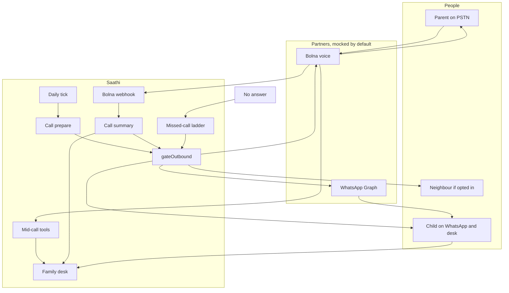

# Architecture

Product specs in [saathi/](./saathi/) win when they disagree with this file.

## System

The parent never opens this website.

## Request flows

**Scheduled call.** `GET/POST /api/cron/tick` with `CRON_SECRET` builds call context, checks the kill switch and allowlist, then places a Bolna call (or a simulated one). `user_data` carries parent id, address term, medicines, and language.

**Mid-call tools.** Bolna POSTs to `/api/tools/*` with Bearer `BOLNA_TOOL_TOKEN`. Tools log doses, mood, memory notes, and alerts. They respond quickly with small JSON.

**Webhook.** `POST /api/webhooks/bolna` stores every delivery. On `completed` with duration, Saathi hydrates transcript, summary, and flags. Replays are idempotent on Bolna execution id.

**Summary and WhatsApp.** After a completed call, briefing or safety templates are filled in the submitted variable order and sent through `gateOutbound`. Unapproved template names fall back to email. Mocks log the payload and do not call Graph.

**Escalation ladder.** No answer, busy, or failed starts same-day retries (`LADDER_RETRY_*`). Later steps notify the child, then an opted-in neighbour. First ack wins.

## Surfaces

| Person | Channel |
| --- | --- |
| Parent | PSTN via Bolna |
| Child | WhatsApp briefing plus `/d/[token]` family desk (PWA) |
| Neighbour | Alert only, if they opted in |

## Apps

| App | Directory | Dev |
| --- | --- | --- |
| Family desk | repo root | `npm run dev` -> :43147 |
| Marketing | `landing/` | `cd landing && npm run dev` -> :43211 |
| Android shell | `android/` | `npm run android:apk` |

## Routes

| Route | Job |
| --- | --- |
| `/` | Sign in / start |
| `/onboard` | Household form + consent |
| `/d/[token]` | Today |
| `/d/[token]/history` | 7 / 30 calendar; every same-day ring is its own row |
| `/d/[token]/alerts` | Alert list |
| `/d/[token]/alerts/[id]` | Alert detail |
| `/d/[token]/calls/[id]` | Call detail (transcript, meds) |
| `/d/[token]/settings` | Pause, test call, consents, install |
| `/ops` | Kill switch, Bolna / WhatsApp readiness (`OPS_EMAILS`) |
| `/admin` | Full household dump + actions (`ADMIN_PASSWORD` cookie, or signed-in `OPS_EMAILS`) |
| `/demo` | EXAMPLE walkthrough |
| `/privacy` | Retention and 112 |
| `/partner/mock/[id]` | Labelled demo pharmacy. No real shop. |

## Data

Postgres-shaped schema. Local: PGlite at `.data/saathi`. Production: `DATABASE_URL` via `pg`.

`npm run db:migrate` applies `src/lib/db/migrations/` in order. Source of truth is the database, not `localStorage` (except the offline `/demo/call` fallback).

Core tables: `parents`, `contacts`, `medicines`, `schedules`, `calls`, `call_attempts`, `dose_logs`, `alerts`, `alert_events`, `memory_notes`, `consents`, `outbound_messages`, `webhook_events`, `magic_links`, `errands`.

Seed rows set `is_example`. The UI shows **EXAMPLE**.

## Environment flags

| Flag | Default in git | Meaning |
| --- | --- | --- |
| `CALL_PROVIDER` | `simulated` | `bolna` only on a live host the owner controls |
| `MOCK_BOLNA` | `1` | No live dials |
| `MOCK_WHATSAPP` | `1` | No Graph sends |
| `MOCK_EMAIL` | `1` | No live mail except configured sign-in OTP |
| `PARTNER_MODE` | `mock` | Demo pharmacy only. Never `link` |
| `SAATHI_KILL_SWITCH` | `0` | `1` freezes outbound |
| `ALLOWED_PHONE_NUMBERS` | empty | Env only |
| `ALLOWED_EMAILS` | empty | Env only |
| `WHATSAPP_TEMPLATES_APPROVED` | `0` | Stay off until Meta approves names |

## Outbound APIs

| Route | Job |
| --- | --- |
| `POST /api/tools/*` | Mid-call tools, Bearer `BOLNA_TOOL_TOKEN` |
| `POST /api/webhooks/bolna` | Store every delivery; hydrate completed calls |
| `GET/POST /api/cron/tick` | Morning calls (`CRON_SECRET`) |
| `GET /api/d/[token]/live` | Desk poll stamp (transcript, meds, alerts) |
| `POST /api/demo/bolna` | Mock scenarios when `MOCK_BOLNA=1` |

Agent JSON: `scripts/bolna/agent.json`, built from `docs/saathi/voice/`. `npm run bolna:sync` prints a diff. `--apply` is owner-only.

## Desk refresh

After a Settings test call or a morning ring, `LiveRefresh` polls `/api/d/[token]/live`. The stamp covers call id, status, transcript presence, open alert, and medicine status so Today and History update as soon as Bolna has words.
