# Design audit — 18 Oct 2026

Phone: **390×844**, mocks on (`CALL_PROVIDER=simulated`, `MOCK_BOLNA=1`, `MOCK_WHATSAPP=1`). Walked EN and हिं. Shots in [`audit-shots/`](./audit-shots/). Recapture: with the family desk running, `AUDIT_BASE=http://127.0.0.1:43177 npx tsx scripts/design-audit-shots.ts`.

This is the punch list for “one product a worried child trusts at 6 am.” Fixes go in follow-up PRs, one area each. Privacy body and consent wording are **out of scope** (awaiting Priyansh).

## Cross-cutting

| Need | Verdict |
| --- | --- |
| Within 1s on Today: is Maa okay, and if not what do I do? | **Mostly.** Good / Act now / Needs a look are the first block, with a primary button. Missed still titles “Needs a look” while the ladder is mid-flight — the action is clear (Call Maa) but the chip is softer than the situation. |
| One visual system | **Not yet.** Desk cards/pills look like PR #41. Setup, `/demo`, `/demo/controls`, `/ops`, `/privacy`, and invite still use mixed type, button radii, and English chrome. Settings is a stack of Save buttons. |
| Setup fully in Hindi | **No.** Every setup step is English-only. There is no `?lang=hi` on `/onboard`. |
| Devanagari wrap | **Fails on Today Act.** Hindi headline parks `AM` on its own line (`माँ ने सीने में दर्द बताया · 8:34` / `AM`). |
| Status without colour alone | **Mostly.** Chips have words + icons (check / triangle). Week dots are colour-only (green vs amber ×) with no text equivalent in the row itself. |
| Empty states say what happens when | **Fails.** Alerts: “No alerts.” History: “No days recorded yet.” Hindi Today empty: “सुबह की कॉल अभी नहीं हुई।” — no “Saathi calls Maa tomorrow at 8:00.” Setup-done is the only screen that names tomorrow’s time. |
| `/demo` on a projector and a phone-to-camera | **Fails.** Title stays English in हिं. Body is 14–16px grey. Hindi lines on the call step are secondary size. `/demo/controls` is a dense operator dump, not a showable morning. |
| 4.5:1, 44px, focus ring | **Mixed.** Primary buttons are 52px. History 7/30 chips are 38px. `--ink-3: #8c8176` on `--background: #fbf7f2` is ~3.7:1 (section labels, home caption, “Demo walks”). `:focus-visible` is a 2px brand ring. |

Do not treat the orange “N Insight” chip in some shots as product UI — that is the Next.js dev overlay.

## Today

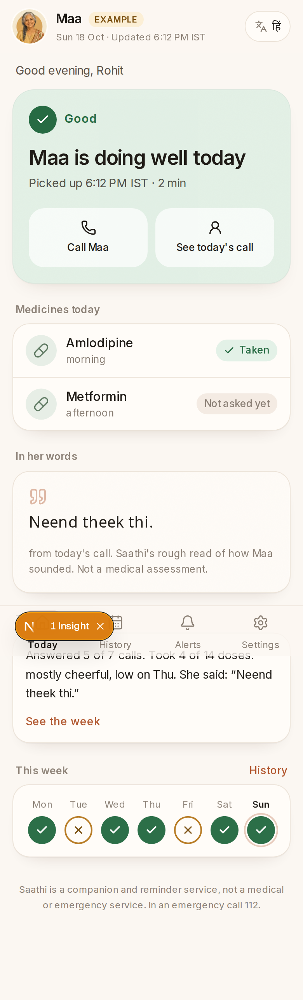

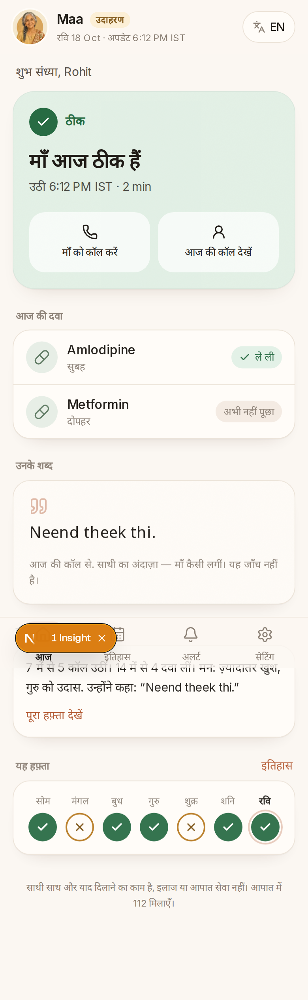

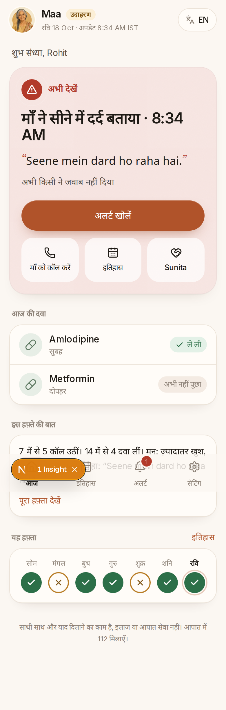

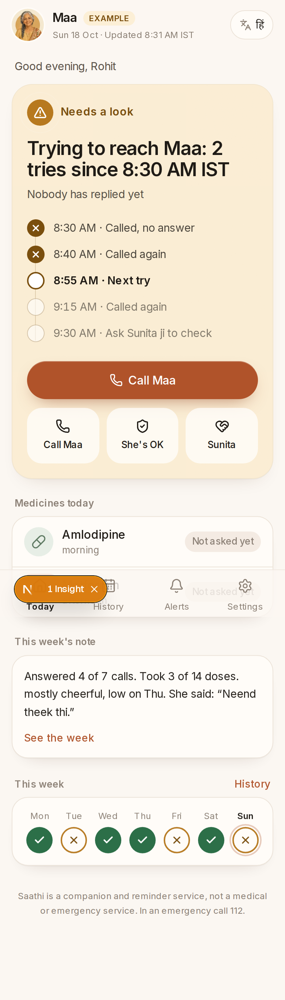

- Hero answers the 6am question: chip + headline + one primary action.
- Hindi Act headline wraps so `AM` sits alone — unreadable at a glance.
- Greeting can say “Good evening” after a mock call that used wall-clock now (seed/demo `chest`/`good` is not always 8:30). Confusing on a morning product.
- Duplicate Call Maa on missed (primary and tile).
- Weekly note sits under the tab bar; “See the week” is easy to miss while scrolling.
- Week strip is icon-only. A colour-blind read of Sun vs Fri needs the History list.
- Medicines use Taken / Not asked yet with a check — good. “Not asked yet” on afternoon Metformin at 6pm mock time looks like we forgot her.
- Companion/112 line is present.

## Alerts list

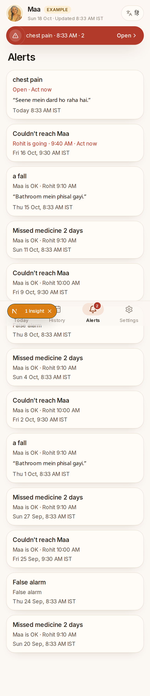

- Open items use **Open · Act now** in words, not colour alone.
- Category titles are lowercase English (`chest pain`, `a fall`) even in the Hindi pack for some seed rows.
- Empty copy is “No alerts.” / “कोई अलर्ट नहीं।” — no “Saathi will write here if a morning goes wrong.”
- The floating Act banner duplicates the first row and eats 48px of the list.
- Quote lines are Latin transliteration, not Devanagari (`Seene mein dard…`).

## Alert detail

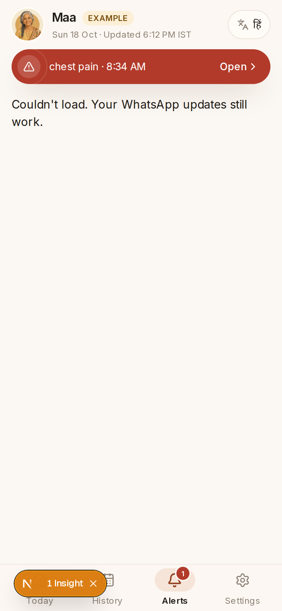

- After a demo `chest` replay the detail route `alert_{day}` 404s into **Couldn’t load. Your WhatsApp updates still work.** — a family-facing error for a missing id, with no way back except the tab bar.
- When it does load, the Act banner still says “Open” on the same alert you already opened.
- Missing-id state is not the shared `ErrorState` (no Retry, no CloudOff).

## History

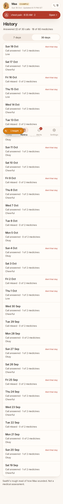

- 7 / 30 toggle is 38px tall (under 44).
- Month names stay English in हिं (`Oct`).
- Empty: “No days recorded yet.” — no “After the first morning, the week will show here.”
- Alert days only add a red “Act that day” tag — colour + small type.

## Call detail

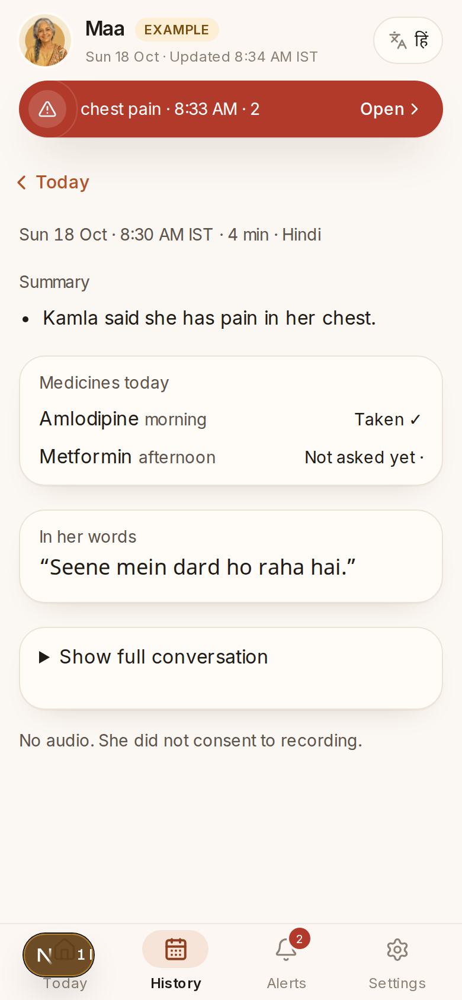

- Useful: time, language, summary bullets, medicines, her words, transcript disclosure.
- Stray `·` after “Not asked yet”.
- This is the only desk page with a `LoadingState` (Suspense). Today/Alerts/History have none by design (perf PR).
- Audio consent line is small muted type at the bottom — easy to miss.

## Settings (incl. neighbour opt-in and weekly access)

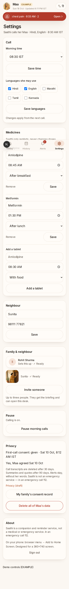

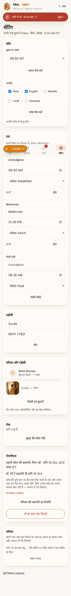

- Looks like an older form: **Save time**, **Save languages**, per-medicine **Save**, neighbour **Save**. One Save (or autosave) would match the rest of the desk.
- Hindi settings still show English / Hindi / Marathi chip labels, “After breakfast”, “With food”, meal English, and Kananda/Marathi left untranslated.
- Neighbour opt-in is a `✓ Ready` / `✕` / `⏳ Waiting` string. Waiting does not say “Sunita has not replied on WhatsApp yet — we will not knock until she says yes.”
- Weekly note lives on Today, not Settings — fine, but Settings has no pointer to it.
- Invite control is English-capable via `t.inviteMember`, but `/invite/[token]` itself is English-only (see below).
- Delete / pause / privacy links are clear. Do not rewrite the privacy paragraph here.

## Setup flow (`/onboard`)

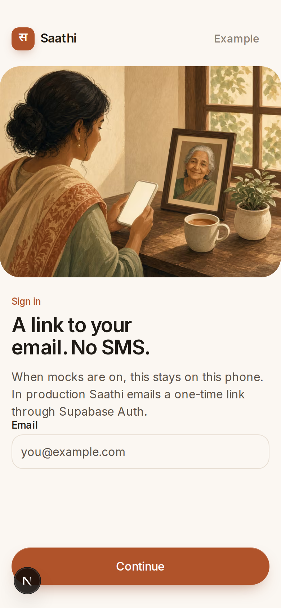

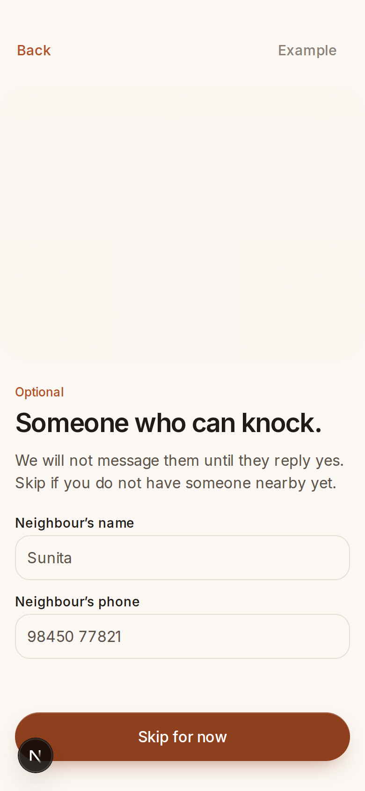

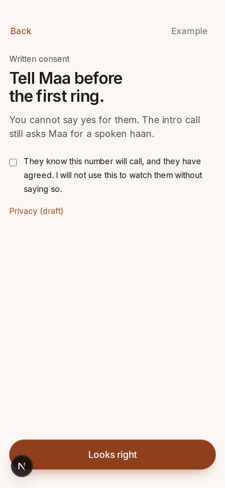

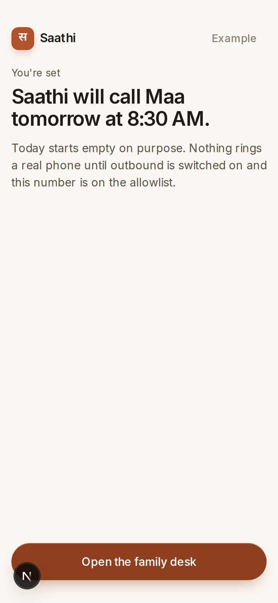

- **English only.** No language toggle. Copy is hardcoded in `src/components/onboard/wizard.tsx`.
- Done screen is the gold-standard empty promise: “Saathi will call Maa tomorrow at 8:30 AM.” Desk empty states should match this sentence.
- Neighbour photo block often paints as an empty cream rectangle (image `fill` in a clipped 4/3 frame).
- Sign-in step talks about Supabase Auth — operator language on a family form.
- Consent checkbox uses `CHILD_WRITTEN_TEXT` (do not change the wording). The chrome around it can still be Hindi.
- Continue / Looks right are 52px. Back is a text control, 44px via `btn-quiet`.

## Family invite

- `/invite/[token]` (`src/app/invite/[token]/page.tsx`) is a separate English client page: “Join this family desk”, Email, Continue, Join. No हिं, no Brand spacing match to setup (different padding, no `field` vs `btn-primary` inconsistency is small but the language gap is not).
- Creating an invite from Settings as a signed-in owner did not always print a URL in this pass — errors stay as a red string, no empty/error card.

## Weekly note

- Shown on Today as “This week’s note” / “इस हफ़्ते की बात”.
- Body is English even on the Hindi desk in the seed (“Answered 5 of 7 calls…”).
- Sits under the tab bar in the 390 layout.

## Privacy

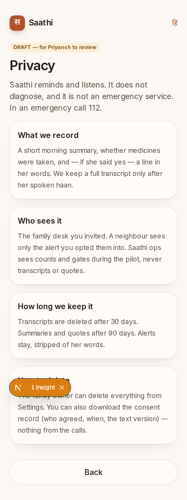

- Draft chip is honest. Type and cards match the desk.
- Do not edit the privacy paragraphs in the polish pass.
- Hindi switch exists (`हिं` / `EN`).

## `/demo` (26 Oct show)

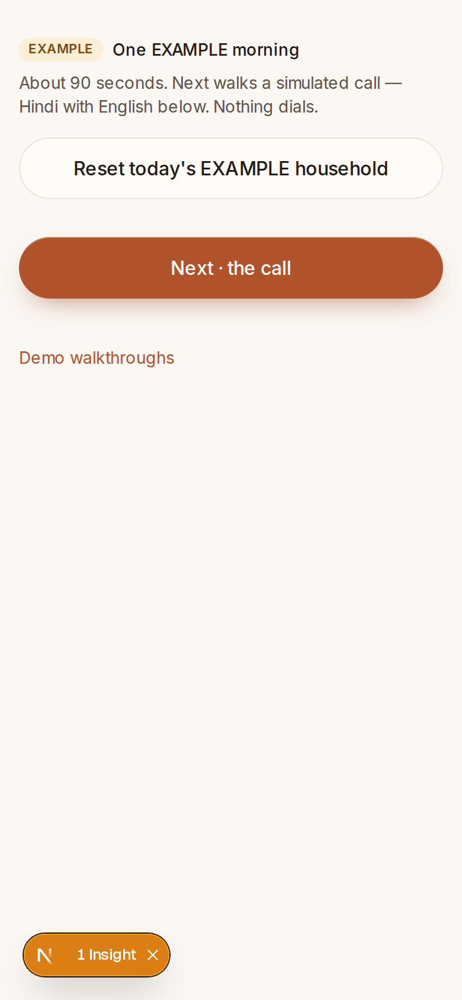

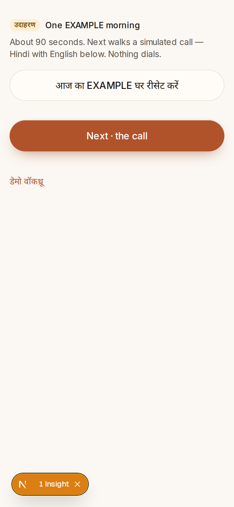

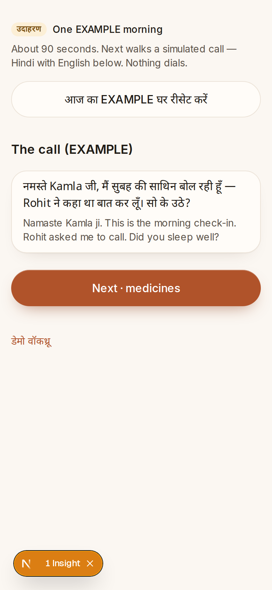

- Shell title “One EXAMPLE morning” and “Next · the call” stay English when `lang=hi`.
- Intro is 14px muted — will wash out on a projector and on a phone held to a camera.
- Call step Hindi is in a card, English underneath — good idea, type is still small (`text-sm` English).
- No progress (“1 / 6”). Easy to get lost.
- Reset is a full secondary button above Next — easy to hit by accident in front of people.

## `/demo/controls`

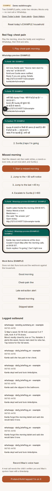

- Operator toolbox, not a showable screen: overlapping type, tiny WhatsApp previews, raw outbound log.
- Fine to keep for Priyansh; it should not be linked from the public home as “Demo walks” in ink-3.

## Practice call (`/demo/call`)

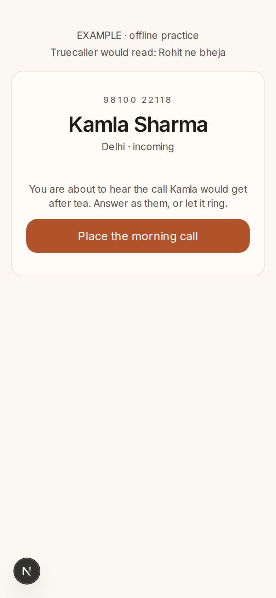

- Calm incoming-call frame. Readable.
- English-only. “Truecaller would read: Rohit ne bheja” is good texture.
- Home still labels this “Hear a practice call” in EN only.

## `/ops`

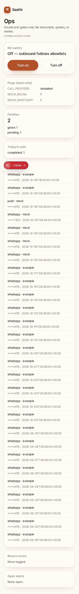

- Useful flags and kill switch. Outbound list is a raw dump (`****-example`, ISO stamps) — ok for ops, ugly.
- Unauthorised `/ops` is the generic **not-found** (“Ask Rohit for a new WhatsApp link”) — same copy as a dead family token. Confusing if Priyansh is signed in on the wrong email.
- No Bolna readiness card yet (Prompt 10 / PR 4).

## Offline / loading / error

- Offline banner exists in chrome (`Last updated at … · offline`) — not re-photographed here (needs the SW cache path). Type uses the same muted tokens.
- `LoadingState`: pulse blocks, used on call detail only. Today has no loading UI (intentional after the perf PR).
- `ErrorState`: CloudOff + “Couldn’t load. Your WhatsApp updates still work.” + Retry. Family `error.tsx` does not pass `lang`, so Hindi desks get English error copy.
- Expired token:

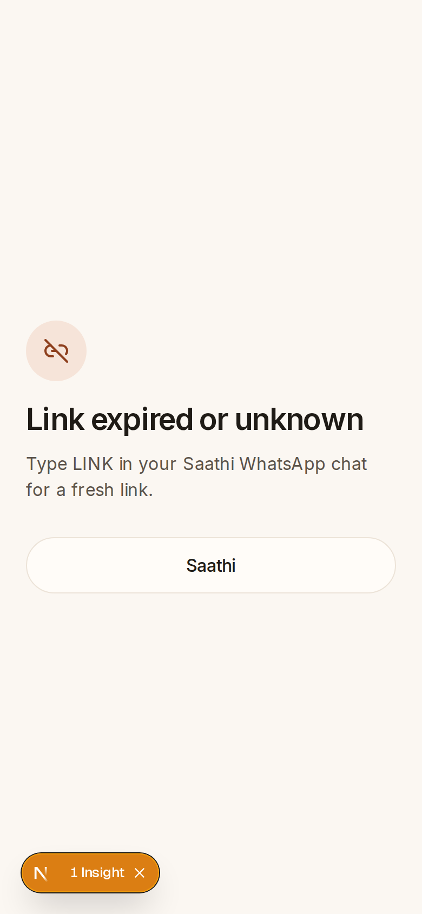

  Clear. Hindi exists. `/` not-found uses different, Rohit-specific copy — two expired metaphors.

## Home (`/`)

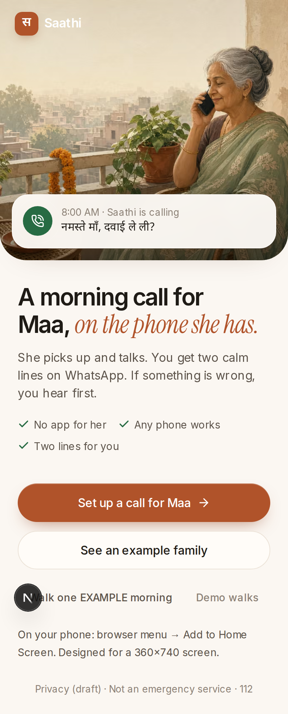

- Matches the brand. English only. “Demo walks” is 13px ink-3 (contrast fail).
- Hindi homepage line exists only as the mock incoming chip (`नमस्ते माँ, दवाई ले ली?`).

## Suggested PR slices (do not mix)

1. **Setup + invite + practice call in Hindi** (copy only; do not change consent/privacy strings).
2. **Empty states** that name the next call time (“Saathi calls Maa tomorrow at 8:00”).
3. **Today/Alerts type**: Hindi wrap, Act vs Look wording, no orphan `AM`, week dots with a text summary already in History.
4. **Settings as one desk**: one Save, Hindi chips/meals, neighbour waiting copy.
5. **`/demo` show mode**: 22–28px type, Hindi chrome, projector contrast, hide controls from the home footer.
6. **A11y tokens**: ink-3 → ≥4.5:1, 7/30 at 44px, error.tsx `lang`.

Prompt 10 (Bolna sync / call context / fixtures / ops readiness / runbook) is separate engineering work and should not land inside these UI PRs.
